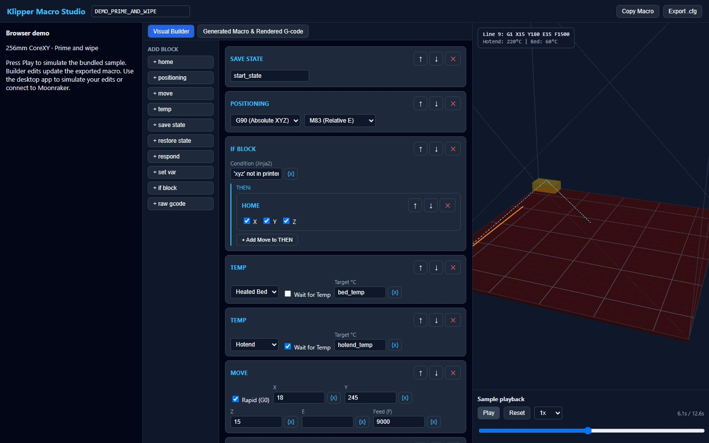
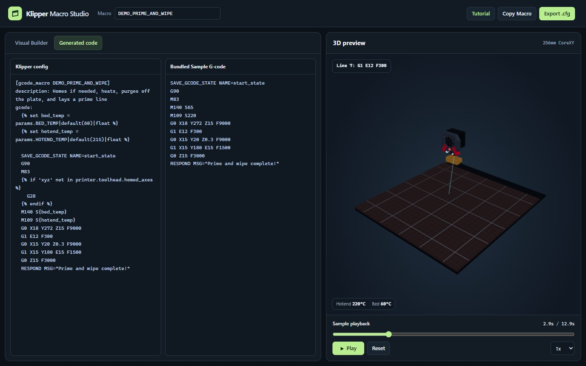

# Klipper Macro Studio

Cross-platform desktop application (Windows, Linux, macOS) to visually build Klipper G-code macros using Klipper's real Python `jinja2` engine and simulate toolhead motion in 3D.

## Download

<!-- download-links:start -->
Latest release: [v0.1.5](https://github.com/newbwormy/klipper-macro-studio/releases/latest)

| Platform | Installer |
| --- | --- |
| Windows x64 | [MSI](https://github.com/newbwormy/klipper-macro-studio/releases/download/v0.1.5/Klipper.Macro.Studio_0.1.5_x64_en-US.msi) · [EXE](https://github.com/newbwormy/klipper-macro-studio/releases/download/v0.1.5/Klipper.Macro.Studio_0.1.5_x64-setup.exe) |
| macOS Apple Silicon | [DMG](https://github.com/newbwormy/klipper-macro-studio/releases/download/v0.1.5/Klipper.Macro.Studio_0.1.5_aarch64.dmg) |
| macOS Intel | [DMG](https://github.com/newbwormy/klipper-macro-studio/releases/download/v0.1.5/Klipper.Macro.Studio_0.1.5_x64.dmg) |
| Linux x86-64 | [AppImage](https://github.com/newbwormy/klipper-macro-studio/releases/download/v0.1.5/Klipper.Macro.Studio_0.1.5_amd64.AppImage) · [DEB](https://github.com/newbwormy/klipper-macro-studio/releases/download/v0.1.5/Klipper.Macro.Studio_0.1.5_amd64.deb) · [RPM](https://github.com/newbwormy/klipper-macro-studio/releases/download/v0.1.5/Klipper.Macro.Studio-0.1.5-1.x86_64.rpm) |
<!-- download-links:end -->

## Browser demo

[Open the live browser demo](https://newbwormy.github.io/klipper-macro-studio/)

The first-run tutorial walks through building a macro, finding commands, previewing motion, and exporting a config. Use **Tutorial** in the header to replay it.

The sample printer shows a Stealthburner-style toolhead over a 256 × 256 mm print plate, with extra Y travel to reach the purge bucket behind the plate.

Try the visual builder, download a `.cfg` file, and play the bundled prime-and-wipe simulation. Editing the macro switches browser playback to its literal G-code. The desktop app evaluates Jinja2 and connects to Moonraker.

To preview locally, run `npm ci` and `npm run dev`, then open the URL printed by Vite. To publish the demo, set **Settings → Pages → Source** to **GitHub Actions**, then run **Deploy browser demo** from the Actions tab.

---

## Screenshots

**Visual builder and 3D sample playback**



**Generated macro and bundled G-code**



## Probe commands

Add a **Probe** block in the visual builder and choose a Klipper, Cartographer, or Eddy-NG command. The block exports the command with any optional G-code parameters you enter. Klipper options include probe status, accuracy, calibration, bed meshing, Z tilt, and gantry leveling. Cartographer options cover status, scan, and touch commands for the current plugin with a `[cartographer]` section.

Probe motion appears in purple in the 3D viewport. The desktop preview uses configured mesh and leveling points when available. In the browser demo, a top-level Probe block plays with the other literal G-code in order. Cartographer touch homing uses a simulated flat-bed reading and marks Z homed after X and Y are homed so subsequent moves can play. Desktop Jinja2 sees an initial mock probe status when it renders a macro. A reading taken during playback becomes available to subsequent simulated probe queries, since Klipper renders a macro before executing its commands. See the [Klipper G-code reference](https://www.klipper3d.org/G-Codes.html) and [Cartographer macro reference](https://docs.cartographer3d.com/cartographer-probe/reference/macros-reference/).

## Command library and macro helpers

Open **Command library** in the builder to see a short description for each entry. Search by command name, module, or purpose. The library lists commands from the [Klipper](https://www.klipper3d.org/G-Codes.html) and [Kalico](https://docs.kalico.gg/G-Codes.html) references, plus selected commands from Cartographer, Eddy-NG, Beacon, KAMP, Shake&Tune, Happy Hare, and AFC. The desktop app also shows descriptions from imported macro configs when provided. Availability and parameters depend on the firmware version and printer configuration.

### Edit macros from your printer

In the desktop app, enter the Moonraker address under **Printer settings** and click **Sync**. The app reads the macro definitions from the configuration Klipper loaded at its last start or restart, including macros loaded from included config files. Choose a macro under **Open macro** and click **Open in editor**. You can also import local `.cfg` files to populate the same picker.

The editor keeps the original G-code or Jinja2 source, inline Kalico Python, and macro options such as `rename_existing` and `variable_*`. Edits stay in the current app session. Use **Export .cfg** to save the edited definition locally. Sync reads from the printer without changing its config. A Kalico `!!include` reference stays a reference to its original source file.

The desktop preview renders the open macro and expands calls to other macros from the imported config. Enter any required arguments under **Test Parameters**. Calls use the mock printer state, and the preview skips Python or external include macros with a diagnostic.

Select **Template helpers** to insert common Jinja2 constructs and actions. For [Kalico Python macros](https://docs.kalico.gg/Command_Templates.html#python), change **Macro language** to **Kalico Python**. The editor inserts Python helpers and exports the required line prefixes. Kalico executes that code on the printer.

The simulator previews supported commands such as motion, probing, speed overrides, heater targets and waits, and fan changes. It reports commands whose effects it cannot model. Firmware configuration, calibration, and plugin behavior still depend on the printer.

---

## Compiling on Linux

### 1. Prerequisites
Install **Node.js 20+**, **Python 3.10+** (with `venv`), **Rust** (`curl --proto '=https' --tlsv1.2 -sSf https://sh.rustup.rs | sh`), and the Tauri v2 system libraries for your distro:

* **Ubuntu / Debian:**
  ```bash
  sudo apt update
  sudo apt install -y libwebkit2gtk-4.1-dev build-essential curl wget file \
    libxdo-dev libssl-dev libayatana-appindicator3-dev librsvg2-dev patchelf \
    python3-venv
  ```
* **Fedora:**
  ```bash
  sudo dnf group install "c-development"
  sudo dnf install -y webkit2gtk4.1-devel openssl-devel curl wget file \
    libappindicator-gtk3-devel librsvg2-devel patchelf python3-devel
  ```
* **Arch Linux:**
  ```bash
  sudo pacman -S --needed webkit2gtk-4.1 base-devel curl wget file openssl \
    appmenu-gtk-module libappindicator-gtk3 librsvg patchelf
  ```

### 2. Build the Python Jinja2 Sidecar
```bash
ARCH="$(uname -m)"
if [ "$ARCH" = "aarch64" ]; then
  TARGET="aarch64-unknown-linux-gnu"
else
  TARGET="x86_64-unknown-linux-gnu"
fi

python3 -m venv .venv
./.venv/bin/python -m pip install --upgrade pip
./.venv/bin/pip install -r sidecar/requirements.txt
./.venv/bin/pyinstaller --onefile \
  --name "macro-engine-${TARGET}" \
  --distpath src-tauri/binaries \
  sidecar/macro_engine.py
chmod +x "src-tauri/binaries/macro-engine-${TARGET}"
```

### 3. Run or Build the Linux App
```bash
npm install

# Run in dev mode:
npm run tauri dev

# Or build release packages (.AppImage, .deb, .rpm):
npm run tauri build
```
Compiled installers are output to:
* `src-tauri/target/release/bundle/appimage/`
* `src-tauri/target/release/bundle/deb/`
* `src-tauri/target/release/bundle/rpm/`

---

## Compiling on macOS (Apple Silicon & Intel)

### 1. Prerequisites
1. **Xcode Command Line Tools:** `xcode-select --install`
2. **Node.js 20+:** `brew install node` (or [nodejs.org](https://nodejs.org/))
3. **Python 3.10+:** `brew install python` (or [python.org](https://www.python.org/))
4. **Rust:** `curl --proto '=https' --tlsv1.2 -sSf https://sh.rustup.rs | sh`

### 2. Build the Python sidecar and desktop app
```bash
ARCH="$(uname -m)"
if [ "$ARCH" = "arm64" ]; then
  TARGET="aarch64-apple-darwin"
else
  TARGET="x86_64-apple-darwin"
fi

python3 -m venv .venv
./.venv/bin/python -m pip install --upgrade pip
./.venv/bin/pip install -r sidecar/requirements.txt
./.venv/bin/pyinstaller --onefile \
  --name "macro-engine-${TARGET}" \
  --distpath src-tauri/binaries \
  sidecar/macro_engine.py
chmod +x "src-tauri/binaries/macro-engine-${TARGET}"

npm ci

# Run in development mode:
npm run tauri dev -- --target "$TARGET"

# Or build .app and .dmg installers:
npm run tauri build -- --target "$TARGET"
```
Compiled artifacts are output to:
* `src-tauri/target/<arch>-apple-darwin/release/bundle/dmg/`
* `src-tauri/target/<arch>-apple-darwin/release/bundle/macos/`

> **Gatekeeper Note (unsigned local builds):** Right-click `Klipper Macro Studio.app` and select **Open**, or run `xattr -cr "/Applications/Klipper Macro Studio.app"` if macOS flags it as from an unidentified developer.

---

## Compiling on Windows

### Prerequisites
1. **Node.js 20+** ([nodejs.org](https://nodejs.org/))
2. **Python 3.10+** ([python.org](https://www.python.org/))
3. **Rust + MSVC Build Tools** ([rustup.rs](https://rustup.rs/) and Visual Studio C++ Build Tools)

### Run Immediately (Dev Mode)
```powershell
powershell -ExecutionPolicy Bypass -File .\dev-windows.ps1
```

### Build Windows `.msi` and `.exe` Installers
```powershell
powershell -ExecutionPolicy Bypass -File .\build-windows.ps1
```
Installers are output to `src-tauri\target\release\bundle\msi\` and `src-tauri\target\release\bundle\nsis\`.

---
